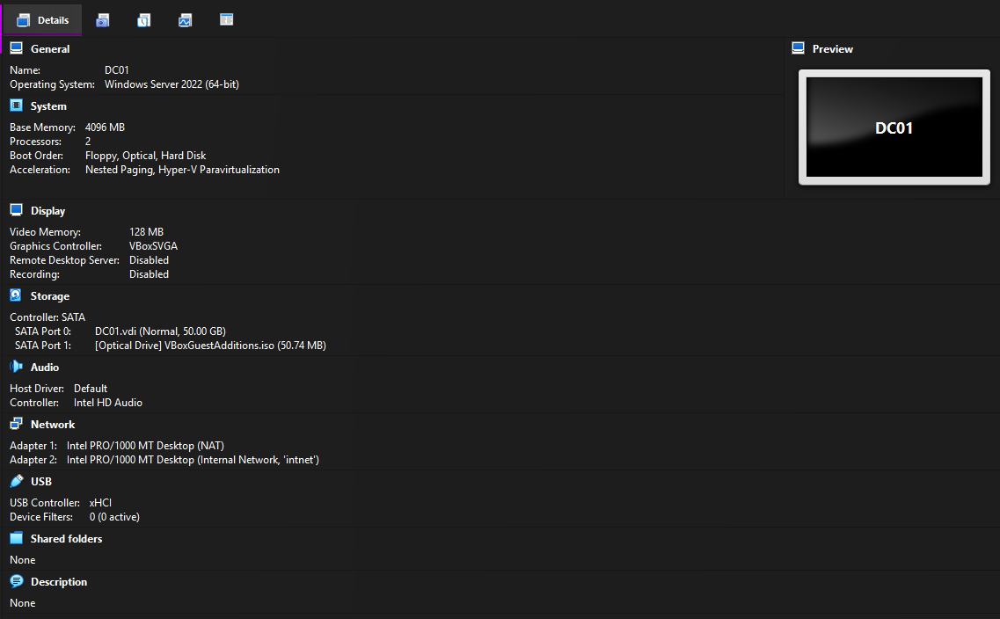

# 01. VM and Windows Server setup

**Goal:** Prepare a Windows Server 2022 virtual machine that will become the domain controller.

## Steps

1. Installed VirtualBox and downloaded the Windows Server 2022 evaluation ISO (English, 64-bit) from the Microsoft Evaluation Center.
2. Created VM `DC01`: 4 GB RAM, 2 CPUs, 50 GB dynamically allocated disk. Unattended installation was disabled to install manually.
3. Installed **Windows Server 2022 Standard Evaluation (Desktop Experience)**, using a custom install on the empty disk.
4. Set the Administrator password and logged in.
5. Renamed the server:

```powershell
Rename-Computer -NewName "DC01" -Restart
```

6. Added a second network adapter in VirtualBox (Internal Network `intnet`) and kept Adapter 1 as NAT for internet access.
7. Set a static IP on the internal adapter: `192.168.10.10/24`, no gateway, DNS `127.0.0.1` (the server will be its own DNS).
8. Installed VirtualBox Guest Additions (better graphics, shared clipboard).



## Problems

- After installation the VM booted into the installer again. See [troubleshooting.md](troubleshooting.md).
