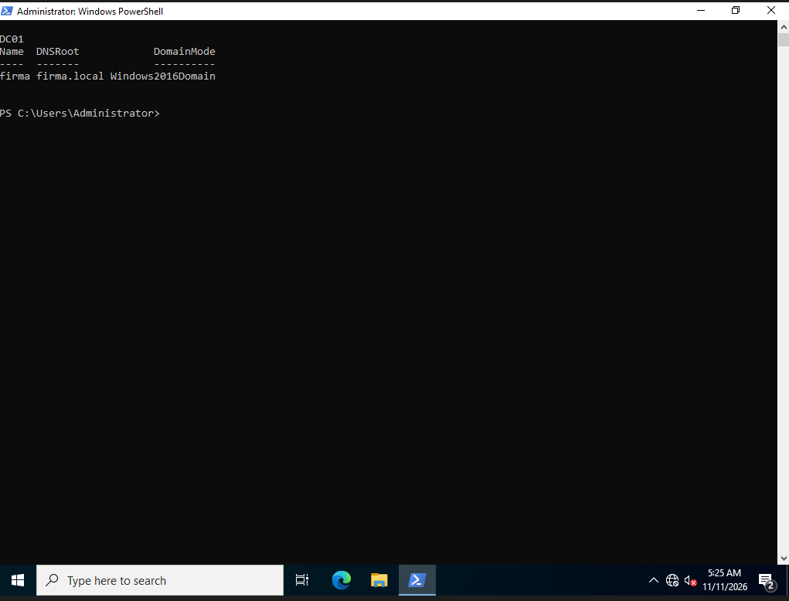

# 02. Domain controller promotion

**Goal:** Install Active Directory Domain Services and create the domain `firma.local`.

## Steps

1. Server Manager, Manage, Add Roles and Features, selected **Active Directory Domain Services** (with management tools).
2. Promoted the server: **Add a new forest**, root domain `firma.local`.
3. Kept the default functional levels, DNS server and Global Catalog enabled, set a DSRM password.
4. NetBIOS name `FIRMA`, default paths, prerequisites check passed, installed. The server restarted automatically.

PowerShell equivalent:

```powershell
Install-WindowsFeature AD-Domain-Services -IncludeManagementTools
Install-ADDSForest -DomainName "firma.local" -DomainNetbiosName "FIRMA"
```

## Verification

```powershell
Get-ADDomain | Select Name, DNSRoot, DomainMode
```

Result: domain `firma`, DNS root `firma.local`.



## Notes

- The first boot after promotion was very slow and looked frozen. It recovered by itself after several minutes. Do not reset the VM during this first boot.
- Took a VM snapshot after promotion (`01-DC-promoted`).
