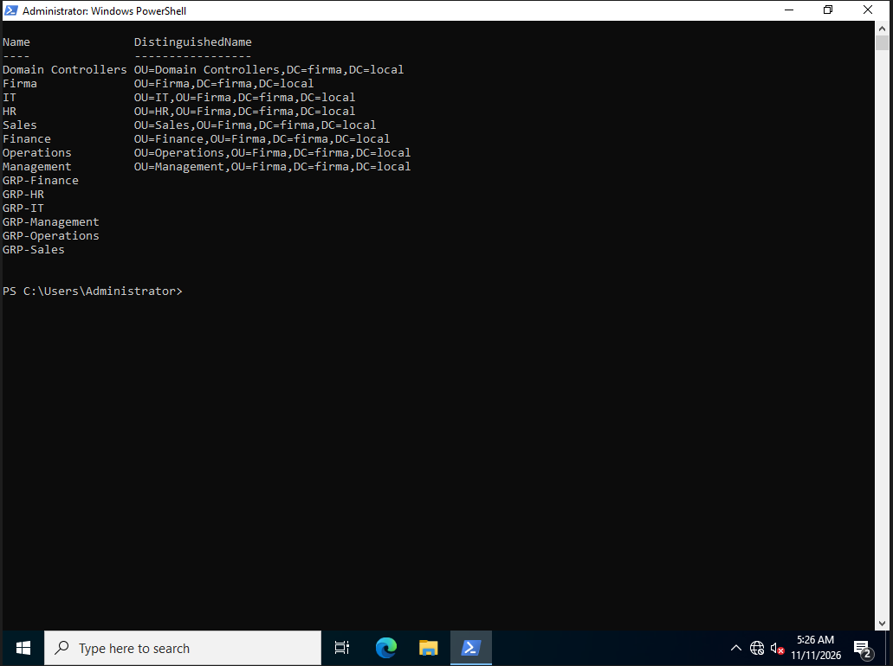
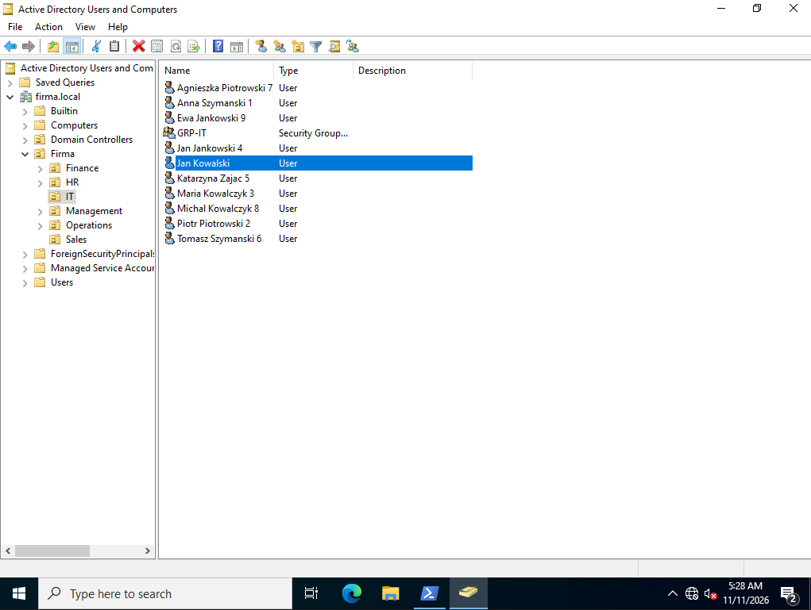
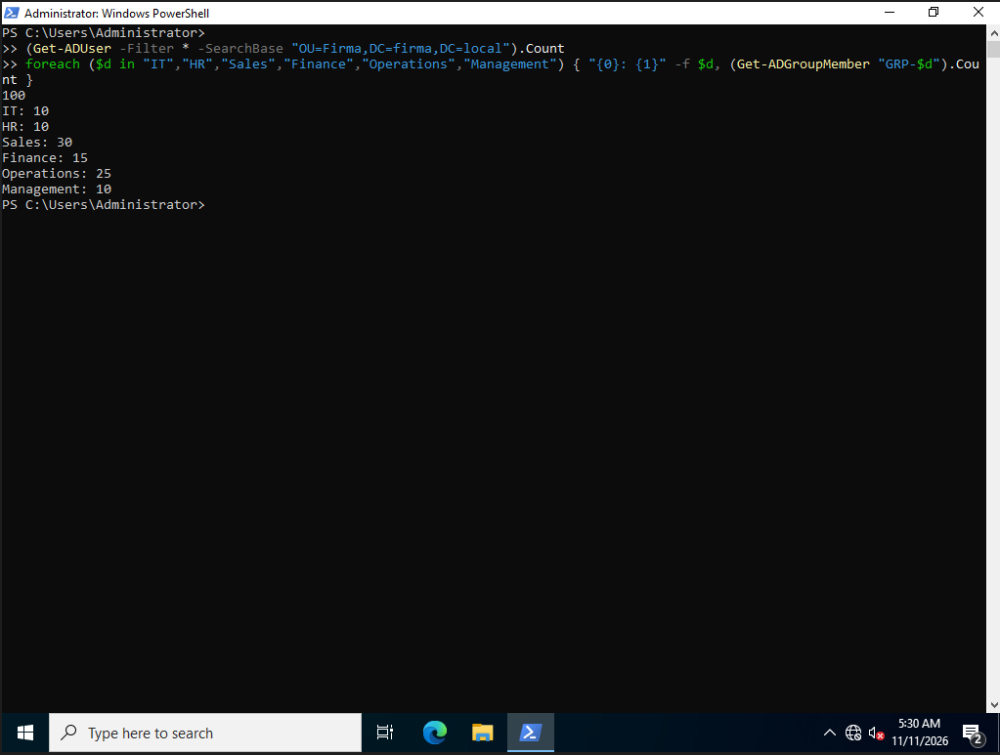

# 03. OUs, groups and users

**Goal:** Build the company structure and create 100 fictional employees with PowerShell.

## Structure

```
firma.local
└── Firma
    ├── IT          (GRP-IT)
    ├── HR          (GRP-HR)
    ├── Sales       (GRP-Sales)
    ├── Finance     (GRP-Finance)
    ├── Operations  (GRP-Operations)
    └── Management  (GRP-Management)
```

Users live in department OUs (not in the default `Users` container), so Group Policy and delegation can be applied per department.

## 1. OUs and security groups

Script: [`create-ou-groups.ps1`](create-ou-groups.ps1)

Verification:

```powershell
Get-ADOrganizationalUnit -Filter * | Select Name, DistinguishedName
Get-ADGroup -Filter "Name -like 'GRP-*'" | Select Name
```



## 2. First user (manual test)

```powershell
New-ADUser -Name "Jan Kowalski" -SamAccountName "jan.kowalski" -Path "OU=IT,OU=Firma,DC=firma,DC=local" -AccountPassword (ConvertTo-SecureString "Welcome123!" -AsPlainText -Force) -Enabled $true
Add-ADGroupMember -Identity "GRP-IT" -Members "jan.kowalski"
```



## 3. Bulk creation of 100 users

Script: [`create-users.ps1`](create-users.ps1). It generates fictional users from first/last name lists, creates each account in its department OU, forces a password change at first logon and adds the user to `GRP-<department>`.

Verification:

```powershell
(Get-ADUser -Filter * -SearchBase "OU=Firma,DC=firma,DC=local").Count
foreach ($d in "IT","HR","Sales","Finance","Operations","Management") { "{0}: {1}" -f $d, (Get-ADGroupMember "GRP-$d").Count }
```

Result: 100 users. IT 10, HR 10, Sales 30, Finance 15, Operations 25, Management 10.



The number in each display name comes from the script counter that keeps names unique.
