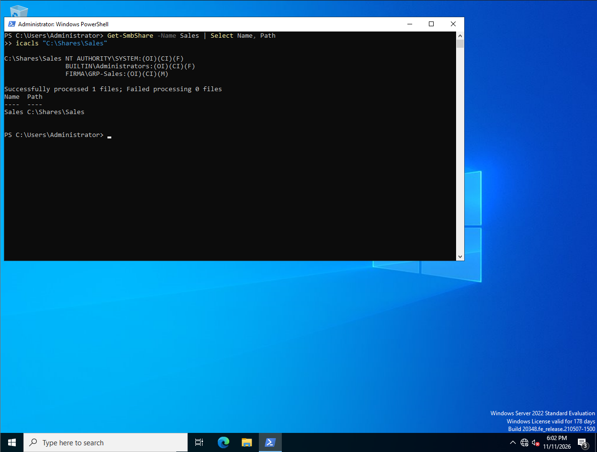

# 04. Network shares and permissions

**Goal:** Give each department its own network folder that only members of that department's security group can access.

## Design

| Share | Path | Group with access |
|---|---|---|
| \\DC01\IT | C:\Shares\IT | GRP-IT |
| \\DC01\HR | C:\Shares\HR | GRP-HR |
| \\DC01\Sales | C:\Shares\Sales | GRP-Sales |
| \\DC01\Finance | C:\Shares\Finance | GRP-Finance |
| \\DC01\Operations | C:\Shares\Operations | GRP-Operations |
| \\DC01\Management | C:\Shares\Management | GRP-Management |

Permissions are assigned to **groups**, not to individual users. Onboarding a new employee means creating the account and adding it to the department group.

## Steps

Script: [`create-shares.ps1`](create-shares.ps1)

For each department the script:
1. creates the folder `C:\Shares\<Department>`,
2. shares it as `\\DC01\<Department>` with full share access for the department group,
3. sets NTFS permissions with `icacls`: inheritance removed, the department group gets Modify, Administrators and SYSTEM get Full Control. Nobody else has access.

First test on a single department (Sales):

```powershell
New-Item -Path "C:\Shares\Sales" -ItemType Directory -Force
New-SmbShare -Name "Sales" -Path "C:\Shares\Sales" -FullAccess "FIRMA\GRP-Sales"
icacls "C:\Shares\Sales" /inheritance:r /grant "FIRMA\GRP-Sales:(OI)(CI)M" "BUILTIN\Administrators:(OI)(CI)F" "SYSTEM:(OI)(CI)F"
```

## Verification

```powershell
Get-SmbShare | Where-Object { $_.Special -eq $false } | Select Name, Path
icacls "C:\Shares\Sales"
```




`NETLOGON` and `SYSVOL` in the list are default Active Directory shares.

## Notes

- `/inheritance:r` removes the default inherited permissions that would let all domain users into the folder.
- Real access testing (Sales user can open `\\DC01\Sales`, HR user gets "Access denied") will be done from a Windows client joined to the domain.
