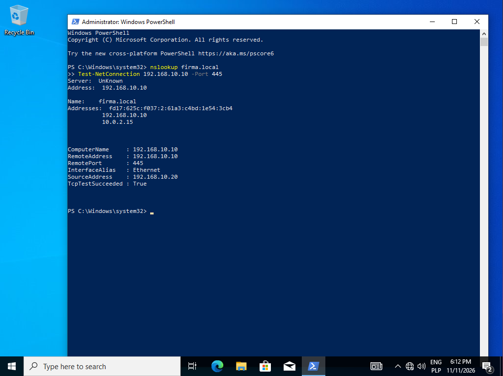
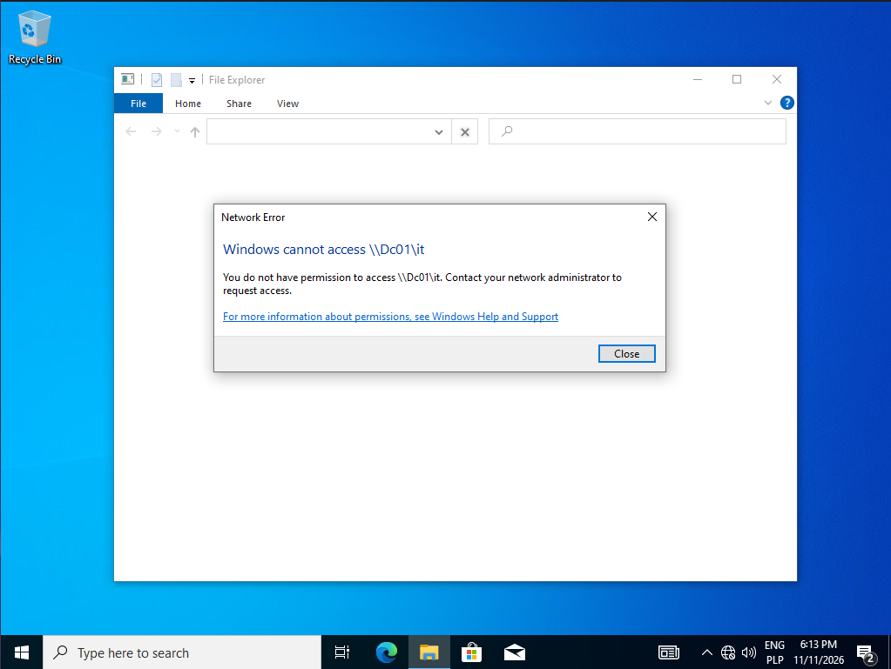

# 05. Windows client and permission tests

**Goal:** Join a Windows 10 client to `firma.local` and verify that department shares are accessible only to the right groups.

## Client VM

| Setting | Value |
|---|---|
| Name | CLIENT01 |
| OS | Windows 10 Pro 22H2 (English, 64-bit) |
| Resources | 4 GB RAM, 4 vCPU, 50 GB disk |
| Network | Internal Network `intnet` (same as DC01), no internet |
| IP configuration | 192.168.10.20/24, no gateway, DNS 192.168.10.10 (DC01) |

Windows 10 **Pro** is required: the Home edition cannot join a domain. The client uses only the internal network, and DNS must point to the domain controller so `firma.local` can be resolved.

## Network check before joining

```powershell
nslookup firma.local
Test-NetConnection 192.168.10.10 -Port 445
```

Result: `firma.local` resolved through DNS at 192.168.10.10 and `TcpTestSucceeded : True` on port 445.

Notes:
- `Server: UnKnown` in the `nslookup` output is harmless (no reverse lookup zone configured).
- `ping` is not used as a test because Windows Server blocks it by default.
- `nslookup` also listed 10.0.2.15, the NAT adapter of DC01. The join worked without changing it.



## Joining the domain

1. `Win + R`, `sysdm.cpl`, Computer Name, Change.
2. Computer name `CLIENT01`, member of domain `firma.local`.
3. Authenticated with the domain Administrator account.
4. Restarted after the "Welcome to the firma.local domain" message.

PowerShell equivalent:

```powershell
Add-Computer -DomainName "firma.local" -NewName "CLIENT01" -Credential FIRMA\Administrator -Restart
```

## Permission tests

Users log in on the client as `FIRMA\<login>`. Accounts created with a forced password change prompt for a new password at first logon.

| User | Department | `\\DC01\IT` | `\\DC01\Sales` | `\\DC01\HR` |
|---|---|---|---|---|
| jan.kowalski | IT | access | access denied | access denied |
| a.nowak20 | Sales | access denied | access | access denied |



The error shown to the user: *"You do not have permission to access \\Dc01\it. Contact your network administrator to request access."* This is the typical message behind helpdesk tickets about missing access.

## Conclusion

Permissions assigned to security groups work as designed. Giving a user access to a department folder only requires adding the account to the department group.
