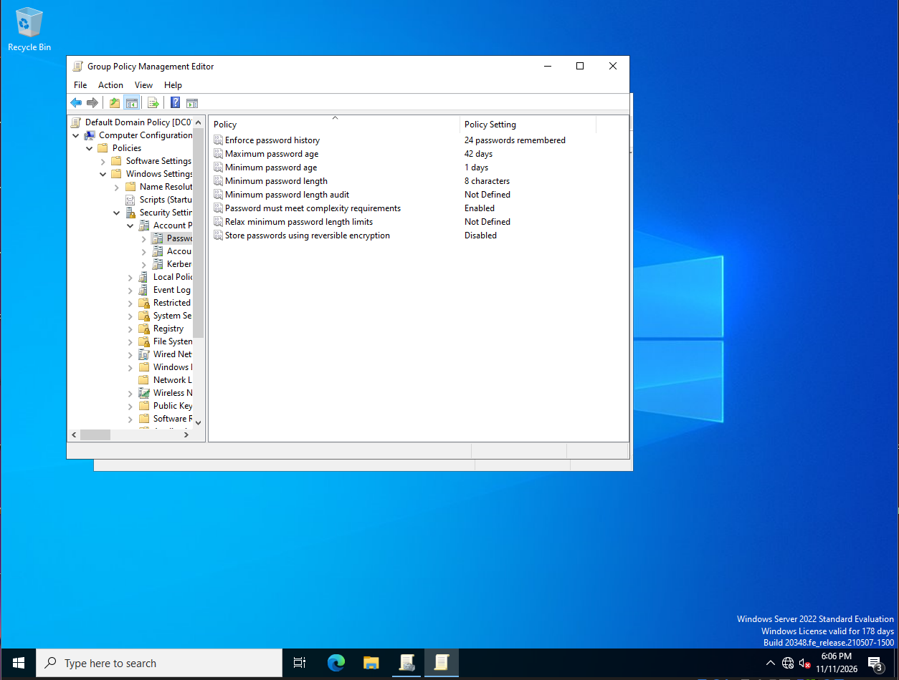
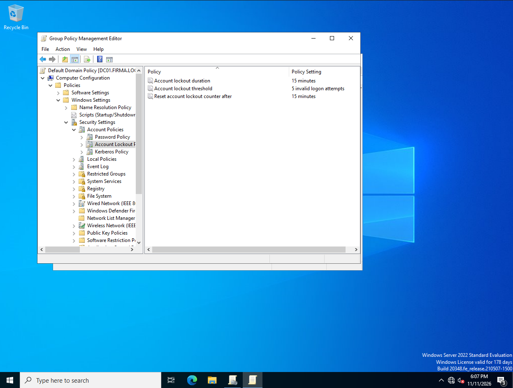
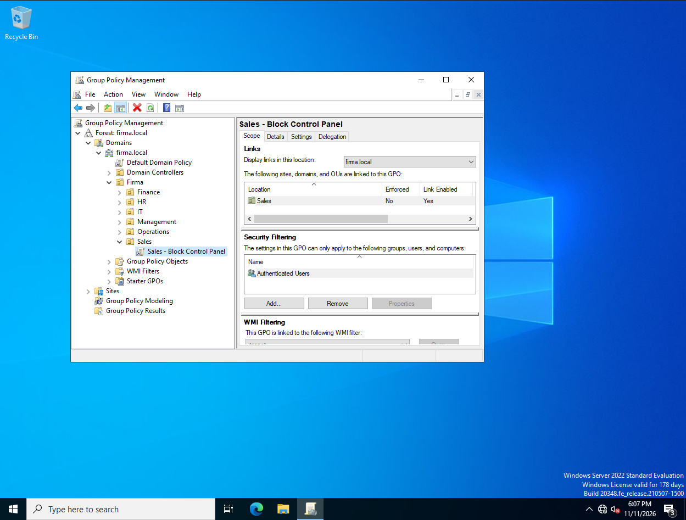
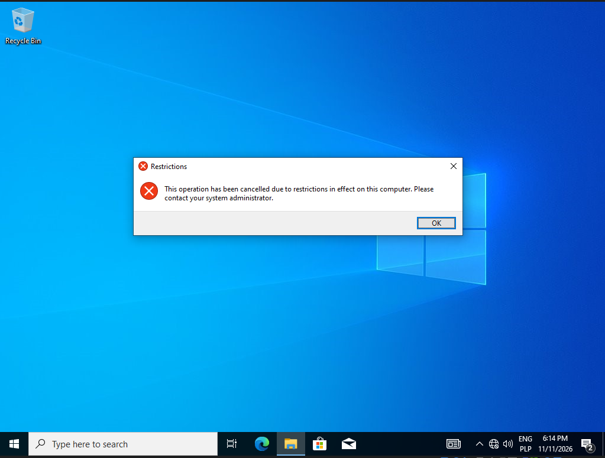

# 06. Group Policy (GPO)

**Goal:** Enforce password and account lockout rules for the whole domain and apply a restriction to a single department.

Policies are managed on DC01 with **Group Policy Management** (Server Manager, Tools).

## GPO 1: Password and account lockout policy (whole domain)

Edited in **Default Domain Policy**, under `Computer Configuration > Policies > Windows Settings > Security Settings > Account Policies`.

| Setting | Before | After |
|---|---|---|
| Minimum password length | 7 characters | 8 characters |
| Password complexity | Enabled | Enabled |
| Account lockout threshold | not defined | 5 invalid logon attempts |
| Account lockout duration | not defined | 15 minutes |
| Reset account lockout counter after | not defined | 15 minutes |

PowerShell equivalent:

```powershell
Set-ADDefaultDomainPasswordPolicy -Identity firma.local -MinPasswordLength 8 -LockoutThreshold 5 -LockoutDuration 00:15:00 -LockoutObservationWindow 00:15:00
Get-ADDefaultDomainPasswordPolicy
```

Existing passwords are not changed. The new length rule applies the next time a password is set.





## GPO 2: Block Control Panel for Sales

A new GPO linked only to the **Sales** OU.

1. Group Policy Management, `firma.local > Firma > Sales`, **Create a GPO in this domain, and Link it here...**
2. Name: `Sales - Block Control Panel`.
3. Edit: `User Configuration > Policies > Administrative Templates > Control Panel`, **Prohibit access to Control Panel and PC settings** set to **Enabled**.

PowerShell equivalent:

```powershell
New-GPO -Name "Sales - Block Control Panel" | New-GPLink -Target "OU=Sales,OU=Firma,DC=firma,DC=local"
Set-GPRegistryValue -Name "Sales - Block Control Panel" -Key "HKCU\Software\Microsoft\Windows\CurrentVersion\Policies\Explorer" -ValueName "NoControlPanel" -Type DWord -Value 1
```



### Test on CLIENT01

User policies apply after a new logon, so after creating the GPO:

```powershell
gpupdate /force
```

then sign out and sign in again.

| User | Department | Opening Control Panel |
|---|---|---|
| a.nowak20 | Sales | blocked: "This operation has been cancelled due to restrictions in effect on this computer. Please contact your system administrator." |
| jan.kowalski | IT | opens normally |



The policy affects only users in the Sales OU. Applied policies can be checked on the client with `gpresult /r`.

## Notes

- Computer policies (password and lockout) are applied to the domain, user policies (Control Panel) follow the user's OU.
- The restriction message is a typical source of helpdesk tickets, so it is also used as a scenario in the helpdesk section.

## Still to test

- Account lockout: five wrong passwords for one account, then unlock with `Unlock-ADAccount`.
- Optional: a drive-mapping preference (`S:` to `\\DC01\Sales`) for the Sales OU.
