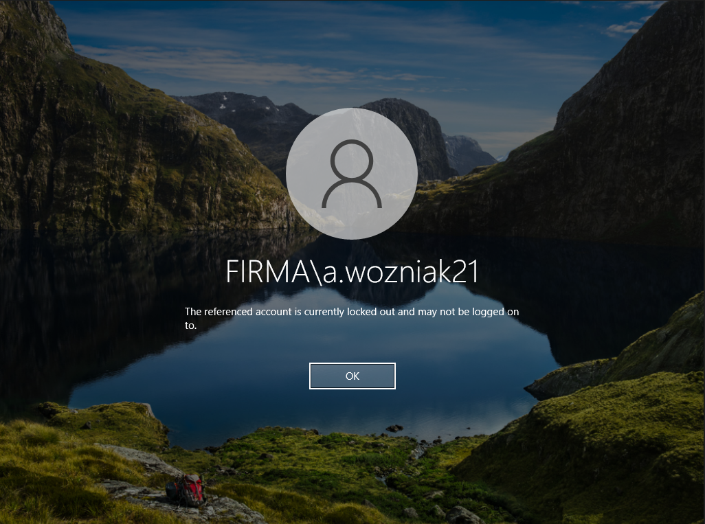
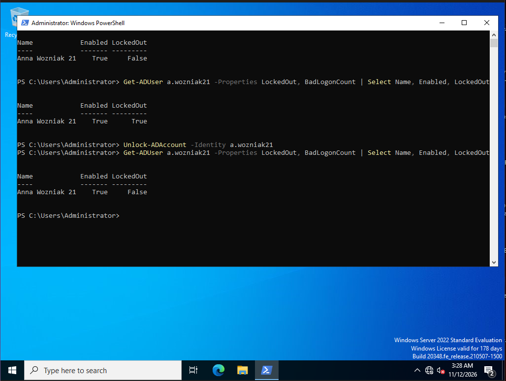
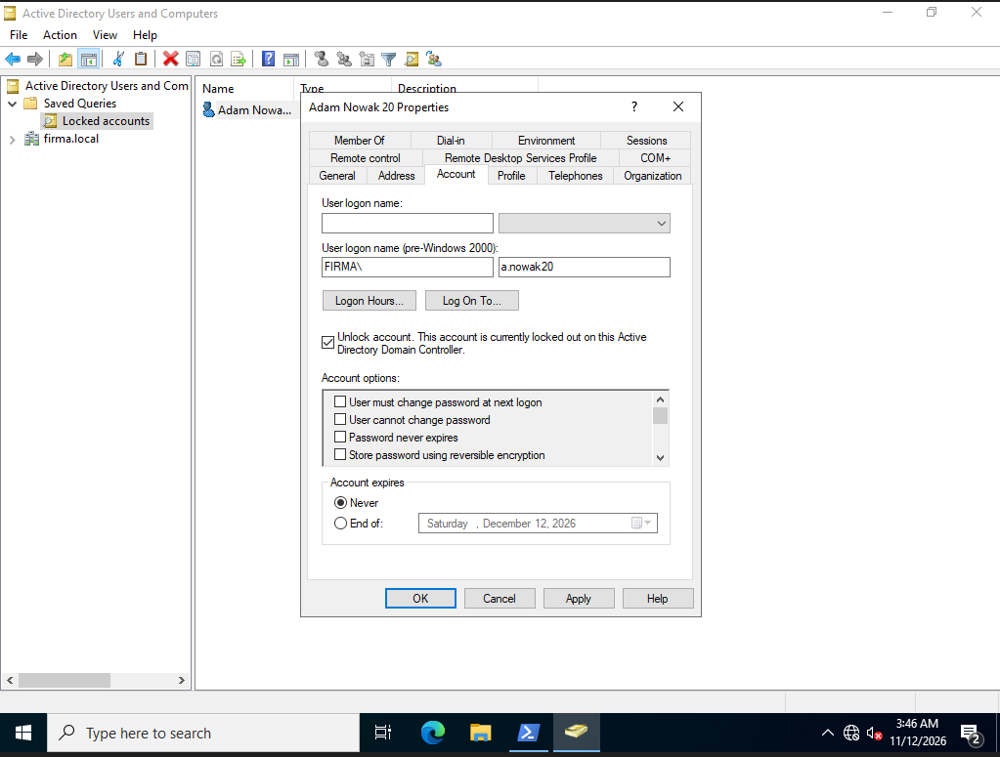
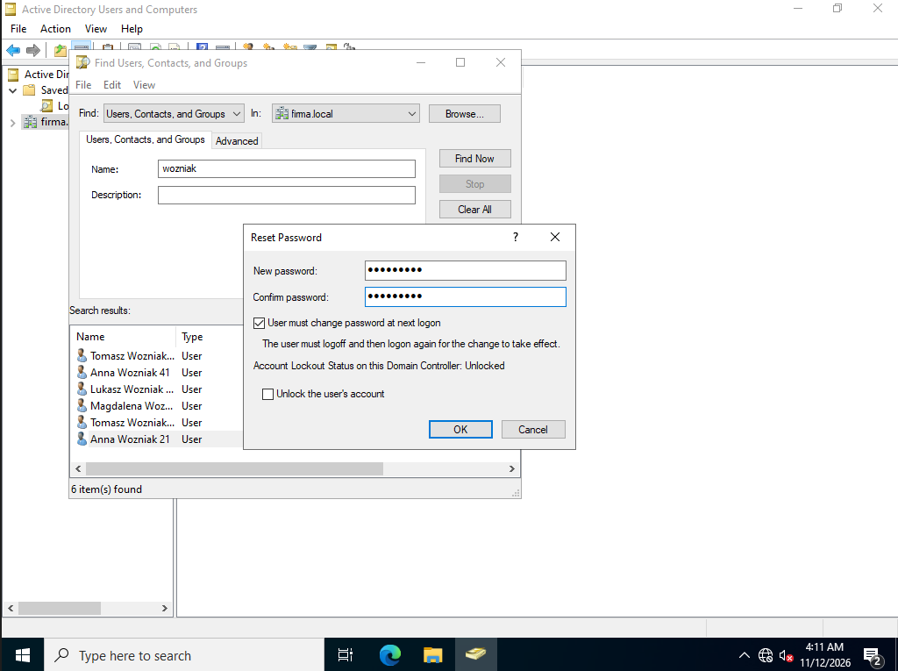

# 07. Helpdesk scenarios

**Goal:** Practice typical helpdesk tickets in the lab: write down the symptom, diagnose it, fix it and verify the result. Users sign in on CLIENT01, administration is done on DC01 with Active Directory Users and Computers (ADUC) and PowerShell.

## Ticket 1: "I cannot log in" (locked account)

**Symptom:** After five wrong passwords the user `a.nowak20` is told the account is locked. This is the account lockout policy from [06-group-policy.md](06-group-policy.md) (5 attempts, 15 minutes).



**Diagnosis:**

```powershell
Get-ADUser a.nowak20 -Properties LockedOut | Select Name, Enabled, LockedOut
```

`LockedOut : True` confirms the cause. In ADUC the same information is on the **Account** tab of the user: the *Unlock account* checkbox only appears when the account is locked.

A saved ADUC query lists all locked accounts at once (Saved Queries, New Query, Custom Search, Advanced):

```
(&(objectCategory=person)(objectClass=user)(lockoutTime>=1))
```

**Fix (GUI):** ADUC, open the user, **Account** tab, tick **Unlock account**, OK.





PowerShell equivalent:

```powershell
Unlock-ADAccount -Identity a.nowak20
```

**Verification:** the user signs in again. Without admin action the account would unlock itself after 15 minutes.

## Ticket 2: "I forgot my password" (password reset)

**Fix:** ADUC, find the user (`firma.local`, Find), right click, **Reset Password...**, set a temporary password and tick **User must change password at next logon**. The temporary password is shared with the user only by a secure channel.



PowerShell equivalent:

```powershell
Set-ADAccountPassword -Identity a.wozniak21 -Reset -NewPassword (Read-Host -AsSecureString "Temporary password")
Set-ADUser -Identity a.wozniak21 -ChangePasswordAtLogon $true
```

**Verification:** at the next sign-in on CLIENT01 Windows asks for a new password. The first new password was rejected by the domain:

> Unable to update the password. The value provided for the new password does not meet the length, complexity, or history requirements of the domain.


The policy requires the minimum length, complexity (several character types), no parts of the account name, and a password that was not used before. A password that met these rules was accepted and the user signed in.

## Ticket 3: "I moved from Sales to HR" (department change)

Two things must change, and they do different jobs:

- the **OU** decides which Group Policies apply to the user,
- the **security group** decides which shares the user can open.

**Fix on DC01:**

1. ADUC, find `a.nowak20`, **Move...** to `Firma > HR`.
2. User properties, **Member Of**: remove `GRP-Sales`, add `GRP-HR`.

PowerShell equivalent:

```powershell
Move-ADObject -Identity (Get-ADUser a.nowak20).DistinguishedName -TargetPath "OU=HR,OU=Firma,DC=firma,DC=local"
Remove-ADGroupMember -Identity "GRP-Sales" -Members a.nowak20 -Confirm:$false
Add-ADGroupMember -Identity "GRP-HR" -Members a.nowak20
```


**Check:**

```powershell
Get-ADUser a.nowak20 | Select Name, DistinguishedName
Get-ADPrincipalGroupMembership a.nowak20 | Select Name
```

Result: `CN=Adam Nowak 20,OU=HR,OU=Firma,DC=firma,DC=local`, groups `Domain Users` and `GRP-HR`.


**Verification on CLIENT01:** group membership is read at sign-in, so the user must sign out and sign in again.

| Test | Result |
|---|---|
| `\\DC01\HR` | opens |
| `\\DC01\Sales` | access denied |
| Control Panel | still blocked right after the move, opens after `gpupdate /force` and a new sign-in (the Sales GPO no longer applies) |


## Summary

| Ticket | Cause | Tool | Result |
|---|---|---|---|
| Cannot log in | Account locked after 5 bad passwords | ADUC / `Unlock-ADAccount` | Account unlocked |
| Forgot password | Password lost | ADUC Reset Password | New password set at next logon |
| Changed department | User in the old OU and group | Move + group change | Access follows the new department |
