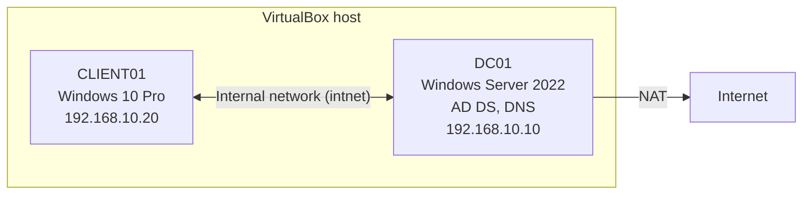

# Active Directory Home Lab: Simulated Company (firma.local)

A hands-on home lab that simulates the IT environment of a company with **100 employees** using Windows Server 2022 and Active Directory. The goal is to practice the daily work of an IT Helpdesk / Support specialist: user and group management, PowerShell automation, Group Policy, network shares and ticket handling.

## At a glance

- Domain controller (AD DS + DNS) and a domain-joined Windows 10 client
- 100 fictional users in 6 departments, created with PowerShell
- Department network shares, access controlled through security groups
- Group Policy: password and lockout policy, per-department restriction
- Helpdesk scenarios: locked account, password reset, department change
- Every step documented with commands, screenshots and a troubleshooting log

## Lab architecture



## Environment

| Component | Details |
|---|---|
| Hypervisor | Oracle VirtualBox 7.2 |
| Server | Windows Server 2022 Standard Evaluation (Desktop Experience), hostname `DC01`, 4 GB RAM, 2 vCPU, 50 GB disk |
| Domain | `firma.local` (NetBIOS: `FIRMA`) |
| Network | DC01: Adapter 1 NAT (internet), Adapter 2 Internal Network (static IP 192.168.10.10/24). CLIENT01: Internal Network only |
| Client | Windows 10 Pro 22H2, hostname `CLIENT01`, joined to `firma.local` (IP 192.168.10.20, DNS 192.168.10.10) |

## Company structure

```
firma.local
└── Firma
    ├── IT          (GRP-IT)          10 users
    ├── HR          (GRP-HR)          10 users
    ├── Sales       (GRP-Sales)       30 users
    ├── Finance     (GRP-Finance)     15 users
    ├── Operations  (GRP-Operations)  25 users
    └── Management  (GRP-Management)  10 users
```

All users are fictional. Accounts are created with an initial lab password and **forced password change at first logon**. Each department has a network share `\\DC01\<Department>` that only its group can open.

## Project steps

1. [VM and Windows Server setup](01-vm-setup.md)
2. [Domain controller promotion](02-domain-controller.md)
3. [OUs, groups and users (PowerShell automation)](03-ou-groups-users.md)
4. [Network shares and permissions](04-network-shares.md)
5. [Windows client and permission tests](05-client-and-permissions.md)
6. [Group Policy (GPO)](06-group-policy.md)
7. [Helpdesk scenarios](07-helpdesk-scenarios.md)

## Helpdesk scenarios

| Ticket | Cause | Fix |
|---|---|---|
| "I cannot log in" | Account locked after 5 bad passwords | Diagnose with `Get-ADUser -Properties LockedOut`, unlock in ADUC or with `Unlock-ADAccount` |
| "I forgot my password" | Password lost | Reset in ADUC with forced change at next logon; the domain rejects a password that does not meet the policy |
| "I moved from Sales to HR" | User still in the old OU and group | Move the user, change the security group, check share access and applied GPOs |

## Scripts

- [`create-ou-groups.ps1`](create-ou-groups.ps1): creates the OU structure and security groups
- [`create-users.ps1`](create-users.ps1): creates 100 fictional users and assigns them to groups
- [`create-shares.ps1`](create-shares.ps1): creates a network share per department, accessible only to its group

## Repository layout

```
.
├── README.md
├── 01-vm-setup.md ... 07-helpdesk-scenarios.md   step-by-step documentation
├── create-ou-groups.ps1, create-users.ps1, create-shares.ps1
├── troubleshooting.md                            problems and fixes
└── images/                                       screenshots used in the docs
```

## Troubleshooting

Problems I ran into and how I solved them: [troubleshooting.md](troubleshooting.md)

## What I learned

- Installing and configuring Active Directory Domain Services
- Designing an OU structure and using security groups
- Automating account creation with PowerShell (`New-ADUser`, `Add-ADGroupMember`)
- Diagnosing and fixing script errors
- Joining a Windows client to a domain and testing share permissions
- Group Policy: password and lockout rules, per-department restrictions
- Handling typical helpdesk tickets: unlocking accounts, resetting passwords, changing a user's department
- Documenting every step

## Reproducing the lab

1. Install VirtualBox, download the Windows Server 2022 evaluation ISO and a Windows 10 Pro ISO.
2. Follow the steps in order (`01` to `07`). The scripts expect the domain `firma.local` and the names used in the docs.
3. Windows Server evaluation is valid for 180 days. Everything here is fictional and meant for a private lab only.

## Possible next steps

- Drive mapping for departments through Group Policy Preferences
- Access groups for shares (for example read-only access to HR documents)
- Onboarding and offboarding tickets
- Changing a user's manager and contact data
